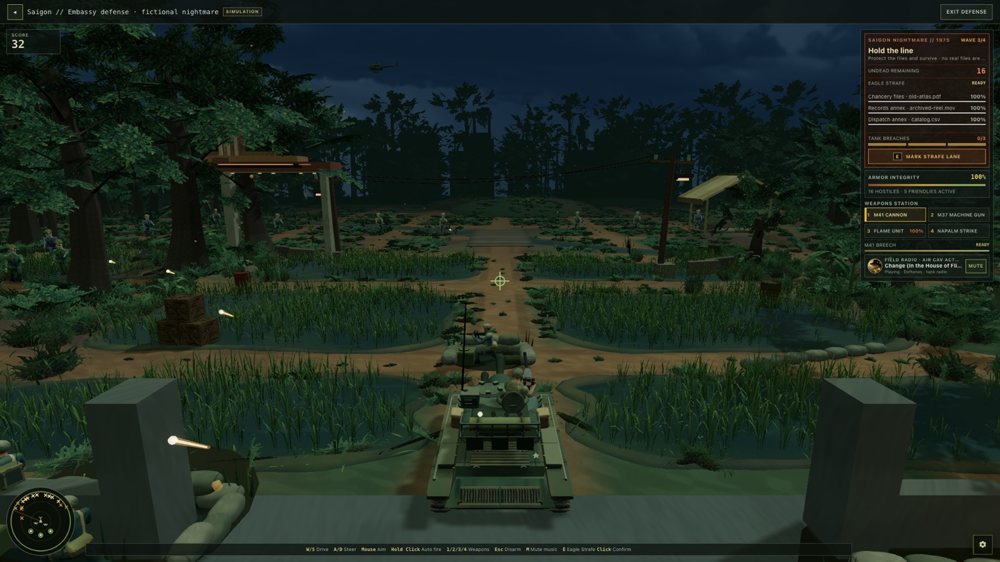

# TankDelete

Drive a tank across one continuous battlefield. The bridge is open from the start, and destroying the last standing village building unexpectedly opens the embassy defense. File targets are fictional: Campaign, Boot Camp, and Horde never select, scan, move, restore, or delete files on your device. The sizes on the scoreboard are game points, not disk space.

## Play this version

### Contributing with Zach

This branch holds the editable React, TypeScript, and Three.js project. [Play the latest published browser playtest](https://samuelprescott-rgb.github.io/tankdelete/) if you just want to play. The old 1613 link opens the same playtest. Publishing is separate from pushing source. To produce the portable browser build, run `npm run build -- --base=./`.

With Git and Node.js 22.12 or newer installed:

```sh
git clone --single-branch --branch codex/zach-playtest-1613 https://github.com/samuelprescott-rgb/tankdelete.git
cd tankdelete
npm ci
npm run dev
```

Open the local URL in the terminal. Edit gameplay and rendering in `src/`; runtime assets are in `public/` and editable art inputs in `art-source/`. Run `npm run build` before pushing. Git checks out the playtest branch when you clone using the command above, so a normal `git push` sends your commits back to that branch.

**Optional Cleanup Desk.** Try **Cleanup Desk → Rehearse with sample files** in the browser. Highlighting a numbered file identifies its hut; firing nominates the file you actually hit. Neither action moves anything. **Review shortlist** shows its full path, even when different folders contain identical names.

The native Mac implementation restricts its picker to twelve individually selected, personally owned regular files in Desktop, Documents or Downloads on the internal local volume. It rejects folders, links, packages, executable and hidden files. Each move requires a separate macOS dialog showing that exact path and byte count; **Keep file** is the default. Changed or unavailable files are rejected. A successful move is recoverable using Finder’s Trash → **Put Back**; there is no permanent-delete or bulk removal command.

From this checkout, run `npm ci` once if dependencies are not installed, then `npm run dev`. Open the **Local** URL printed by Vite and choose **Start Campaign** or **Boot Camp**. No desktop app, folder access, account, or test files are needed. This description applies to this source tree, not previously published installers.

**Local Mac test status:** The [protected Workshop build](docs/local-workshop-webkit.md) renders the native menu and Cleanup Desk on this Mac. The original distribution profile is unchanged and still reproduces a blank window here. Launching the desk is not the same as qualifying real cleanup: [the decision tests](docs/cleanup-desk.md) use simulated files and an inert mover. No real file was moved during QA.

For the **Ghost Signal** art test, add `?ghostSignal=river` or `?ghostSignal=embassy` to that URL. Both scenes are playable from the practice menu. At the bridge, aim at the siding of a nearby file hut and fire once; press Escape to disarm and test a different spot, or hit the same hut again to confirm virtual trash. At the embassy, defend the three sample archives. Leaving either scene returns to the practice menu and does not unlock campaign Horde. Run `npm run check:ghost-signal` for the scoped visual and gameplay regressions.

To see the campaign airlift, choose **Start Campaign** and look down the village road. In the opening half minute a transport lands beside the road, a three-person squad gets out and fights, and a separate aircraft goes down beyond the ridge. Reinforcements are ordinary allies: they can be hurt and lost. In **Embassy approach**, watch the rifle line and the landing zone as well as the archives. A zombie can leave its file run to attack a nearby defender.



## Controls

| Input | Action |
|-------|--------|
| W / S | Drive forward / backward |
| A / D | Rotate tank left / right |
| Mouse | Aim turret |
| Left Click / Hold | Fire; hold for automatic weapons |
| 1 / 2 / 3 / 4 | Select cannon / machine gun / flamethrower / napalm |
| X / Delete | Trash every armed target |
| Escape | Disarm all targets |
| M | Play or mute the field radio |
| Cmd/Ctrl + Z | Undo the last trash action |
| Right Click + Drag | Orbit camera to look around |

## Gameplay

- **Campaign pressure:** twelve initial opponents plus two finite six-person tunnel waves. An amber hatch beacon and radar cue warn before anyone surfaces. The patrol tank and reserves harass the player while the village is being cleared; there is no radio interaction.
- **Field supplies:** drive over a green cross to restore up to 22 hull, or an amber shield for 16 points of spare armor. Each map has one of each per attempt. Full health leaves a repair kit in place, and plates do not stack. Horde breaches and archive damage are not prevented by hull supplies.
- **Picture clarity:** the bridge uses the same full-frame sampling as the rest of the field. Pixel and ASCII work live in the assets, water and plank damage; crossing an invisible boundary no longer coarsens the entire picture.

- **Start Campaign** puts you on one field. Cross the bridge in either direction, face the patrols and demolish the village, including the riverside shelter and rear hut. File huts can be marked and trashed in any order; the two scenery structures do not erase a file.
- **Horde** starts automatically when the final building collapses. No driving to a marker or pressing a key is required. The embassy receives surviving simulated files, or the radio transcript if none remain. The earned **Horde Mode** menu replay keeps those file names. For a drop-in test without earning or changing a replay, tune the small **∿** in the main menu’s bottom-right corner.
- **Boot Camp** is a separate practice arena. Neither ordinary training nor the Ghost Signal embassy practice awards a campaign unlock.
- **Between waves**, one field kit can repair a damaged archive, brace an intact one or reinforce the tank. Skip it to resume early, or the next wave starts when the 12-second workshop ends.
- **Files** appear as labelled buildings in the village. You can review the fictional field files without leaving the battlefield.
- **Campaign aiming** uses the surface under the cursor, including slopes, paddies, the river and roofs. Each round leaves the muzzle and can strike cover on the way. Two cannon hits collapse the fishing shelter or radio hut. The mast survives.
- **First hit** marks a file without changing it; a second hit or X / Delete moves marked targets to virtual Trash.
- **Cannon** sends a single descending arcade round from the muzzle. The moving practice crawler demonstrates a direct shield hit, a glancing rebound and a short shutdown.
- **Driving** uses an eased pullaway and coast; the two tracks and their road wheels follow the terrain independently. The turret takes time to catch up to the pointer; the sight indicates its current alignment. Look back after crossing the bridge: paired tread marks stop at the planks and start again on soft ground. A hit briefly kicks up dust at the point of contact and can leave a scuff on that part of the tank.
- **M37 machine gun** follows the cursor while firing ten rounds per second, with a maximum reach of 30 field units.
- **Flamethrower attachment** reaches up to 11 field units. A building hit by the jet keeps burning for about six seconds after contact ends. The fuel supply lasts four seconds and recharges over five seconds.
- **Napalm support** calls in a timed F-4 approach, then burns a 20-by-5.5-unit rectangular strike corridor with a ten-second cooldown
- **Score** rewards simulated bytes cleared; undo restores the target and reverses its score.
- **Achievements** unlock at 100MB, 1GB, and 10GB milestones

## Features

- `AO CLEAN SWEEP // 1968` weathered olive, amber, and field-map visual system
- Mud road grid, mottled ground cover, relief mounds, reflective puddles, blade-built elephant grass, jungle perimeter, drifting smoke, field fortifications, and a distant UH-1-inspired flyover
- File targets rendered as huts, longhouses, bunkers, and radio structures while retaining category-colored outlines and labels
- Continuous flamethrower stream, fuel/recharge meter, glowing high-visibility tracer streaks, and a small F-4 Phantom-inspired flyover that releases each napalm strike before impact
- Integrated cannon, M37 burst, flamethrower, napalm-impact, engine-loop, and gear-shift sound effects
- Low-volume battlefield ambience mixed beneath vehicle, weapon, and radio audio
- Switchable tank radio and separate encounter effects
- Voxel shatter explosions with category-colored particles
- Scoring system and achievement toasts
- Radar minimap showing nearby files and combatants
- In-memory trash with last-in, first-out undo

For fixed-camera visual comparisons and separate browser/desktop performance evidence, see the [extended playtest ledger](docs/extended-defense-gauntlet.md).

## Optional desktop build

Requires [Rust](https://rustup.rs/), [Bun](https://bun.sh/), and platform dependencies for [Tauri v2](https://v2.tauri.app/start/prerequisites/).

```bash
# Install dependencies
bun install

# Run in development
bun run tauri dev

# Build release installer
bun run tauri build
```

## Safety

- Every weapon preserves the two-stage mark/confirm deletion rule
- Automatic fire can affect each target only once per trigger hold, so the player must release and fire again to confirm deletion
- `Escape` disarms the target queue and Cmd/Ctrl+Z restores the last trash action
- Virtual file commands accept only exact IDs from fixed fictional fixtures. A host path or an unknown ID is rejected, never resolved.
- Campaign has no desktop operations. The packaged Mac Cleanup Desk has three restricted commands: native picker, individual token review and forgetting a selection. No IPC accepts a host path; a shot never invokes the Trash operation. Historical filesystem-scanning and deletion modules are not compiled. There is no general filesystem plugin.
- Pending napalm impacts are canceled when leaving an arena
- Failed batch deletions remain armed so they are never hidden from the player

Run `npm run check:campaign` to verify the one-field objective and `node scripts/run-field-journey.mjs PORT` against a local production preview for the full driving route (requires Playwright and Chrome). Run `npm run check:simulation` and `npm run check:cleanup` to exercise both boundaries. The latter compiles a native list/consent/commit-order test on Mac with an inert commit callback. No QA target is a real file.

## License

MIT
